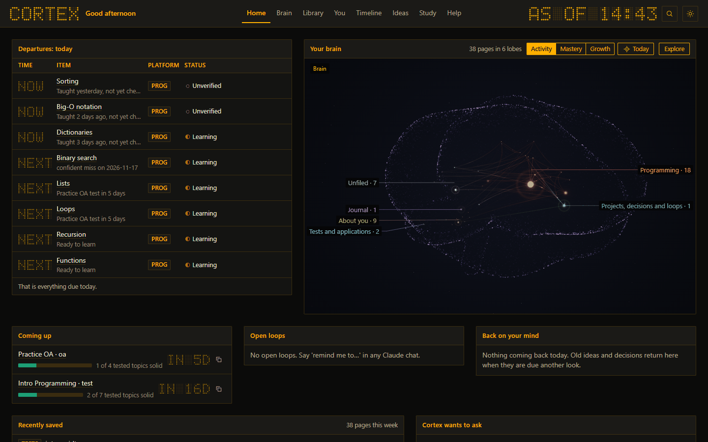
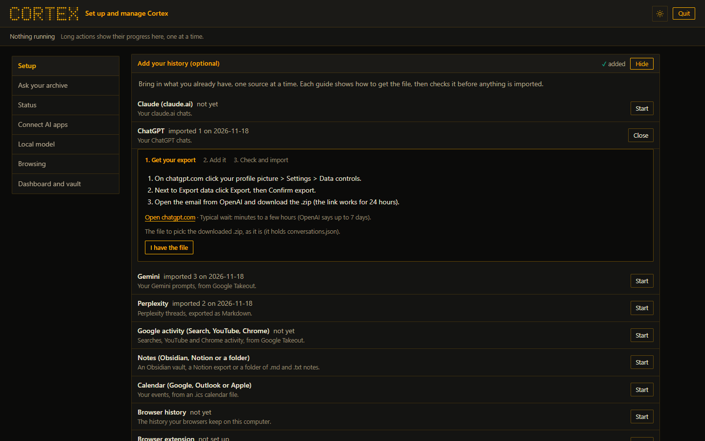
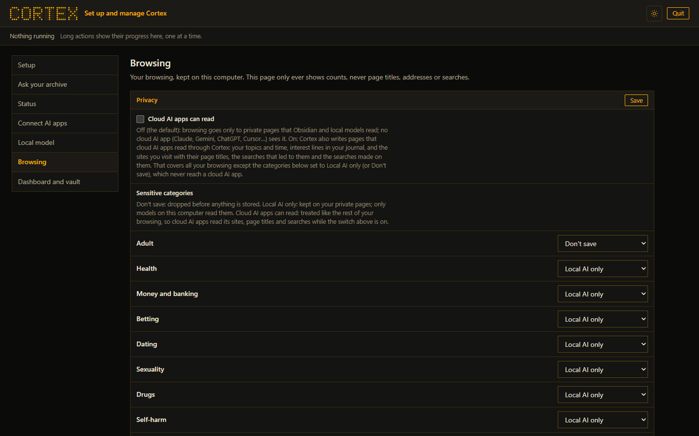
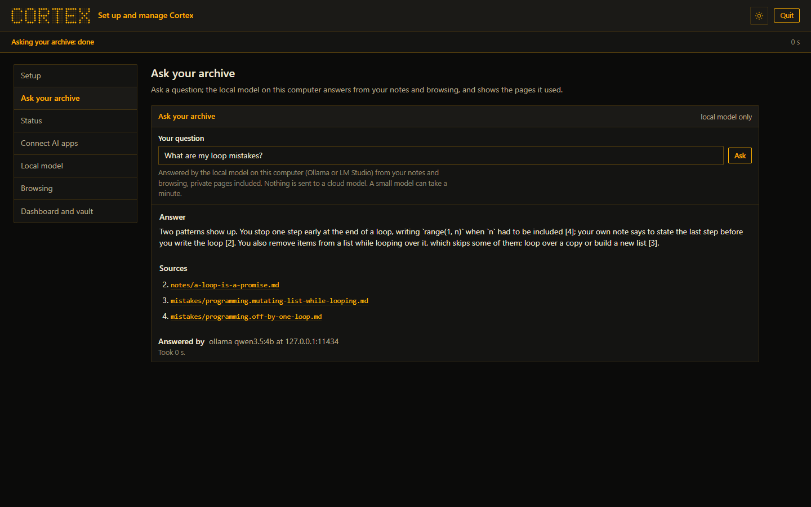
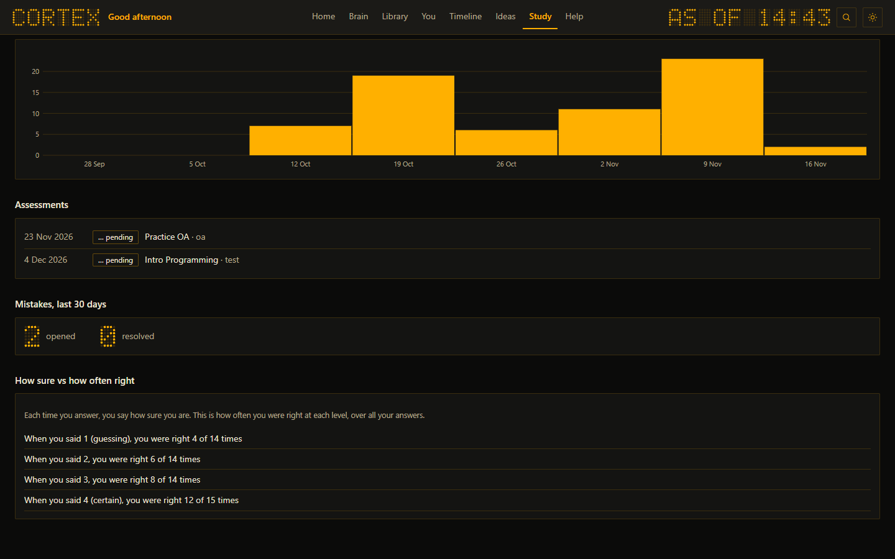
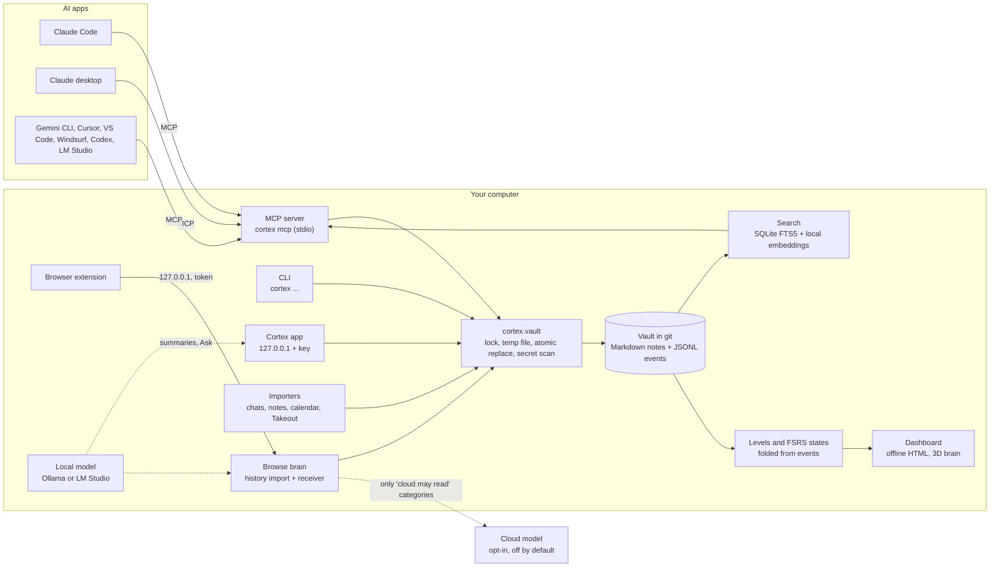

# Cortex

Cortex is a second brain and study planner that lives on your own computer and that Claude and other AI apps can read and write through MCP.



*Every screenshot in this README shows the bundled sample learner, Sam, plus made-up demo data. None of it is a real person's.*

## Contents

- [What Cortex does](#what-cortex-does)
- [A tour](#a-tour)
- [How it works](#how-it-works)
- [Privacy](#privacy)
- [Install](#install)
- [First run](#first-run)
- [Using it](#using-it)
- [Local models](#local-models)
- [Development](#development)
- [FAQ and troubleshooting](#faq-and-troubleshooting)
- [License](#license)

## What Cortex does

Cortex keeps a model of you as a learner and a store of what you know, in a folder of plain Markdown and JSONL files (the *vault*). Every AI app you connect reads from it and adds to it, so a new chat already knows what you are studying, what you keep getting wrong and what is due.

- **It remembers what you study.** Quiz answers, grades, mistakes and lessons are events in an append-only log. Mastery levels and FSRS-6 memory states are worked out from that log every time, never stored by hand, so a wrong grade can be cancelled and everything recomputes.
- **It remembers what you get wrong.** Each mistake has its own page with the pattern and the fix. A wrong answer you were sure of (a *confident miss*) stays at the top of your plan until you get it right on a later day.
- **It plans what to revise.** A daily plan (Today) orders lessons taught but not yet checked, confident misses, refreshes that are due, topics for the next test and new topics. You can cut it to the time you have.
- **It works with the AI apps you already use.** An MCP server gives Claude Code, the Claude desktop app, Gemini CLI, Cursor, VS Code, Windsurf, Codex, LM Studio and other MCP clients the same tools. A `/cortex` skill adds study modes to Claude.
- **It brings in your history.** Import chat exports (claude.ai, ChatGPT, Gemini, Perplexity), notes (Obsidian, Notion, any folder), calendars (.ics), Google activity and your browser history.
- **It stays on your computer.** No account, no telemetry. The vault is a normal Obsidian vault with its own git history, so every change can be reviewed and undone.

## A tour

### The Cortex app

`cortex app` opens a page on this computer (127.0.0.1, with a key that changes each launch). It walks a new user through setup and then manages everything else.

**Setup** goes one step at a time, and every step can be skipped and done later.


**Status** shows each part of Cortex on this computer and what to do when one needs you.


**Add your history** has a three-step guide for each source: how to get the export, adding the file, then a check of what it found before anything is imported.



**Browsing** sets who may read each category of your browsing: *Don't save*, *Local AI only* or *Cloud AI apps can read*. Adult is not saved by default, and every other sensitive category starts as local-only.



**Ask your archive** answers questions from your notes and browsing with a model on this computer, and lists the pages it used. It never uses a cloud model.



*The answer in this screenshot comes from a stand-in for a local model, used to make the demo repeatable; the sources are the real search results for the sample vault.*

**Local model** shows the runner (Ollama or LM Studio) and the chosen model.


### The dashboard

`cortex dashboard` writes a single offline HTML page from your vault and opens it. It has no network access (its content security policy is `default-src 'none'`).

The **Study** tab shows today's plan in order, the tests coming up with how ready you are, and your open mistakes.


Further down are answers per week, your assessments, and the **confidence mirror**: how often you were right each time you said you were 1 (guessing) to 4 (certain). It is a mirror only and never changes your plan. A level shows a share only after 10 answers.



The readiness forecast for a test stays hidden until Cortex has 30 checked reviews to calibrate it ("Forecast after 30 checked reviews"); until then you see only the share of tested topics that are solid.

### The 3D brain

The **Brain** tab draws your vault as a brain: each topic is a lobe with its own colour, bright fibres are your own links, faint fibres join pages with similar meaning, and a halo marks pages saved in the last 7 days. Drag to turn, scroll to zoom, click a page to see its connections. A 2D map and a list are one click away. It uses WebGL2 and falls back to a flat canvas.


### Study planning

- **Today.** `cortex today` prints the plan; `cortex today --minutes 30` keeps the plan's order and drops what does not fit (the minutes are estimates).
- **Mock paper.** `/cortex mock paper 30` in Claude builds a timed practice paper from your weak spots for the next test, mixed across subjects.
- **Mock interview.** `/cortex mock` runs coding, aptitude, HR and project rounds, then a debrief. Weak topics come back in your plan for 14 days.
- **Sweep.** `/cortex sweep` asks 10 cold questions across subjects, each with "how sure? 1-4", to catch what you only think you know.
- **Digest.** `cortex digest` goes through chats imported since the last digest and suggests up to 3 topics each, using local search only. A yes records that the chat touched the topic; it never counts as a grade.

## How it works



- **The vault is the source of truth.** Notes are Markdown with YAML front matter; learning evidence is JSONL events under `events/`. Every write goes through one module that takes a lock, writes a temp file and replaces the old one atomically, and refuses text that looks like a secret. Each chat's changes are one git commit.
- **Everything else is derived and disposable**: the search index, the vector cache, levels, the plan and the dashboard. Delete them and Cortex rebuilds them.
- **Search** combines SQLite full-text search with a small embedding model that runs locally (about 150 MB, downloaded once).
- **Note text is treated as untrusted.** Over MCP it is wrapped in `<untrusted_note>` tags so the model can tell your notes from instructions; in cards and the dashboard it is escaped and stripped of links and images.

### A study session, step by step

1. You type `/cortex learn` in Claude. The skill calls `cortex_start`, which opens a session and returns the plan.
2. For each item Claude usually calls `cortex_ask` to log the question (and, when it has one, a short expected answer), then asks you. You answer and say how sure you are, 1 to 4.
3. Claude calls `cortex_grade` with the verdict, the hints used and any mistake. The server stamps the event's id, time and source; the tool input cannot set them.
4. The levels fold replays the log: the concept's state (Not started, Unverified, Learning, Needs refresh, Solid) and its FSRS memory card (stability, difficulty, next due date) update.
5. The next `cortex_start` or `cortex today` plans from the new state. When the chat ends, the session closes and its changes become one git commit; `cortex undo <session>` reverts it.

The tool schemas are in [docs/tools.md](docs/tools.md).

## Privacy

Cortex is local-first. [docs/PRIVACY.md](docs/PRIVACY.md) has the full detail; in short:

- **No account and no telemetry.** Your vault is a folder you choose; settings live in `~/.cortex/`.
- **What reaches the internet** happens only because you asked: the one-time search model download, and in the app, downloading Ollama or a local model when you click. Installing or upgrading fetches Python packages as usual.
- **Servers listen on 127.0.0.1 only.** The app needs a key that changes each launch and stops after 30 minutes idle. The browser extension's receiver accepts only the paired extension's token. The MCP server talks over standard input and output.
- **What the AI model sees.** Whatever a Cortex tool returns goes to the AI app you are chatting with (Anthropic, when you use Claude). Pages marked `private: true` are left out of search, recall and context. `cortex exclude add <folder>` turns Cortex off for chats in one folder.
- **Browsing has three settings per category.** *Don't save* (adult, by default), *Local AI only* (health, money, betting, dating, sexuality, drugs and self-harm start here: only a model on this computer may read them), or *Cloud AI apps can read*. Nothing from browsing is visible to cloud AI apps until you turn that switch on. Sign-in, payment and bank pages are dropped and never stored.
- **The cloud model is off by default.** If you opt in, it may sort and summarise only the *Cloud AI apps can read* categories. It needs an HTTPS endpoint, reads its API key from an environment variable you name (the app never takes a key), sends at most 500 requests a run unless you change the cap, refuses a request that looks like it holds a secret, and logs counts only. It never sees a skipped or local-only category, and if no local model is running, local-only data is skipped rather than sent.
- **Local models stay local.** Cortex talks to Ollama or LM Studio on loopback only, ignores proxy settings and refuses models that a local runner forwards to the cloud.
- **Do not publish your vault.** It holds your profile and private pages; a pre-push hook in the vault refuses `git push`.

## Install

### Windows: the installer

1. Download `CortexSetup.exe` from the [Releases page](https://github.com/alenissacsam-2/cortex-learner/releases).
2. Double-click it. The file is not signed, so Windows SmartScreen may say it "protected your PC": click **More info**, then **Run anyway**.
3. Click **Install**. It needs an internet connection this once, to download Python and Cortex's parts (a few minutes). It needs no admin rights and installs for your user only, in `%LOCALAPPDATA%\Programs\Cortex`, and adds `cortex` to your PATH.
4. Click **Open Cortex**. Later, use the **Cortex** shortcut on the desktop or in the Start menu.

To update, run a newer `CortexSetup.exe`. To uninstall, click **Quit** in the app, then remove **Cortex** under **Settings > Apps > Installed apps**. Your vault and `~/.cortex` settings are kept; delete them yourself if you want them gone. Silent install options are in [docs/INSTALL.md](docs/INSTALL.md).

### macOS, Linux, and developers

You need [uv](https://docs.astral.sh/uv/getting-started/installation/) and git. In a terminal:

```
git clone https://github.com/alenissacsam-2/cortex-learner ~/Cortex-app
cd ~/Cortex-app
uv tool install --editable .
~/.local/bin/cortex app
```

On Windows without the installer, use PowerShell:

```
git clone https://github.com/alenissacsam-2/cortex-learner "$HOME\Cortex-app"
cd "$HOME\Cortex-app"
uv tool install --editable .
& "$HOME\.local\bin\cortex.exe" app
```

Keep the `Cortex-app` folder: the installed program runs from it (it also holds the Claude Code plugin, the Chat skill and the browser extension). If a new terminal says `cortex` is not found, run `uv tool update-shell` and open a new terminal. [docs/INSTALL.md](docs/INSTALL.md) has every step for a first-time user, manual setup for each client, updating and a full uninstall.

## First run

The app's **Setup** walks through:

1. **Vault.** Pick a folder (default `~/Cortex`). Cortex adds its own subfolders, starter pages about you and a git history, and never changes notes already there.
2. **Connect AI apps.** Tick the apps to connect: Claude Desktop, Claude Code, Gemini CLI, Antigravity, Cursor, VS Code, Windsurf, LM Studio or Codex. Each change is shown first, and each config file is backed up before it is edited.
3. **Search model.** A one-time download of about 150 MB. Without it, search uses keywords only.
4. **Add your history** (optional). One guide per source, as in the screenshot above.
5. **Local model** (optional). Finds or installs Ollama, suggests a model that fits this computer, downloads it, tests it with a made-up sentence and turns it on.
6. **Try it.** A reminder to restart the apps you connected, and first things to say to Claude.

Prefer a terminal? `cortex setup` asks the core questions (vault, sample, search model, Claude Code plugin, Claude desktop config) and runs the checks. `cortex setup --dry-run` shows the plan and changes nothing; `cortex setup --sample` adds the sample learner, Sam, so you can try things at once (`cortex sample remove` clears it later).

After connecting, restart Claude Code or fully quit and reopen the Claude desktop app.

## Using it

### With Claude

Talk normally. In Claude Code, the plugin adds a short Cortex context to the first message of each chat; in the desktop app, Claude calls `cortex_prime` itself. Claude records lasting things as they come up and tells you briefly what it wrote. Anything about who you are (a preference or personality line) is saved only after you say yes.

Type `/cortex [mode] [topic]` for a deliberate session. The main modes:

| Command | What it does |
|---|---|
| `/cortex` | Home card: what's due and what's waiting for you |
| `/cortex learn [topic]` | Today's plan: retrieve first, teach the gap, re-test |
| `/cortex review` | Only what is due for a refresh |
| `/cortex short` | At most 5 small steps, for tired evenings |
| `/cortex sweep` | 10 cold questions across subjects, each with "how sure?" |
| `/cortex mock` | A mock interview; `/cortex mock paper [15\|30\|45]` for a timed paper |
| `/cortex week` | This week's numbers and the confidence mirror |
| `/cortex about <topic>` | What you know and have on a topic |
| `/cortex capture` | Save a source and the ideas worth keeping |
| `/cortex reflect` | The weekly review: confirm or drop lines about you, spot-check grades |
| `/cortex help` | Every mode and command |

[docs/GUIDE.md](docs/GUIDE.md) explains every mode, the 3D brain, browsing and the terms Cortex uses.

### In a terminal

| Command | What it does |
|---|---|
| `cortex app` | Open the Cortex app (`--no-open` prints the link only) |
| `cortex today --minutes 30` | Today's plan, cut to 30 minutes |
| `cortex import <file>` | Import a chat export, notes, a calendar or Google activity; `--dry-run` shows counts, `--private` keeps imported notes private |
| `cortex digest` | Review chats imported since the last digest and confirm their topics |
| `cortex ask "question"` | Answer from your notes and browsing with your local model, with sources |
| `cortex recall "query"` | Search your vault by meaning and keywords |
| `cortex dashboard` | Build and open the offline dashboard |
| `cortex doctor` | Health check, with a fix for each problem |
| `cortex backup` | Zip the whole vault, history included |
| `cortex undo <session>` | Revert one chat's changes |
| `cortex exclude add <folder>` | Turn Cortex off for chats in a folder |

`cortex --help` lists every command. The MCP tools and event schemas are in [docs/tools.md](docs/tools.md).

### Browsing

`cortex browse scan` shows counts of your browser history without writing anything; `cortex browse import` turns it into pages, private by default. The optional browser extension (Chrome, Edge, Brave) adds time on screen and short excerpts; see [extension/README.md](extension/README.md). [docs/GUIDE.md](docs/GUIDE.md) section 6 covers every step and setting.

## Local models

A local model is optional. Cortex uses it to sort and summarise your browsing and to answer **Ask your archive**. It never leaves your computer.

- **Ollama** is recommended: the app's Setup can install it (`winget` on Windows, Homebrew on macOS; on Linux it shows the command).
- **LM Studio** is the alternative, through its own `lms` command.

Model sizes the app suggests (Qwen 3.5):

| Memory (graphics memory with an NVIDIA card, otherwise RAM) | Model |
|---|---|
| under 6 GB | `qwen3.5:2b` |
| 6 to 10 GB | `qwen3.5:4b` (the default) |
| 10 GB or more | `qwen3.5:9b` |

Without an NVIDIA card the app recommends at most the 4B model; the 9B one stays selectable. Without the app: install Ollama, run `ollama pull qwen3.5:4b`, add `localllm: {enabled: true}` to `~/.cortex/config.yaml`, and check with `cortex llm status`.

## Development

```
git clone https://github.com/alenissacsam-2/cortex-learner cortex
cd cortex
uv sync
uv run pytest -m "not slow"   # the quick loop
uv run pytest                 # the full suite, before a commit
uv run ruff check
```

Always run Python through `uv run`. Tests use only synthetic data in `tests/fixtures/`; two read-only smoke tests run against a real vault only when `CORTEX_REAL_VAULT` is set. The rules for contributors and AI agents are in [CLAUDE.md](CLAUDE.md), and [filemap.md](filemap.md) describes every file.

- **Windows installer:** `uv run python installer/build.py` builds `dist/CortexSetup.exe` (Windows only). The sources are in [installer/](installer/).
- **The `/cortex` skill:** edit `skills/cortex/`, then run `uv run python scripts/build_skills.py` to refresh the plugin copy and `dist/cortex-skill.zip`.
- **A demo vault:** `uv run cortex init <folder>` then `uv run python scripts/make_demo_vault.py <folder>` fills a throwaway vault with the sample learner and made-up study history, as in the screenshots. Never point it at a real vault.

Layout in brief: `src/cortex/` is the Python package (`vault.py` for every write, `events.py` for the log, `levels.py` for the folds, `planner.py` for Today, `mcp_server.py` for the tools, `cli.py` for the commands, `app/` for the Cortex app, `browse/` for browsing); `src/cortex/assets/` holds the dashboard and app pages; `plugin/` is the Claude Code plugin; `extension/` is the browser extension.

## FAQ and troubleshooting

Start with `cortex doctor`: it checks each part and prints a fix for anything wrong.

**`cortex` is not found.** Run `uv tool update-shell`, then open a new terminal. (The Windows installer adds it to PATH for new terminals.)

**The Claude desktop app shows `cortex` as failed.** Use the full path to `cortex` in `claude_desktop_config.json` (find it with `where.exe cortex` or `which cortex`), then fully quit and reopen the app. [docs/INSTALL.md](docs/INSTALL.md) section 7 has the entry to paste.

**The first reply in a Claude Code chat is slow.** The plugin's hook is loading your context. It waits at most 3 seconds, then asks Claude to load it instead.

**The search model download failed.** Search still works with keywords. Retry with `cortex model download`.

**Doctor warns about cloud sync.** Move the vault out of OneDrive, Dropbox, Google Drive or iCloud: sync can break Cortex's file lock and copies private pages off your computer.

**`git push` is refused in my vault.** On purpose: the vault's pre-push hook keeps it local.

**My day ends late.** Cortex starts a new day at 04:00 in your computer's time zone.

**Can I use it without Claude?** Yes. Any MCP client can connect, and the CLI, the app and the dashboard work on their own. The `/cortex` study modes are a Claude skill.

**Where is my data?** In the vault folder you chose, plus settings and the search model in `~/.cortex/`. To remove everything, follow [docs/INSTALL.md](docs/INSTALL.md) section 11.

## License

MIT. See [LICENSE](LICENSE).
