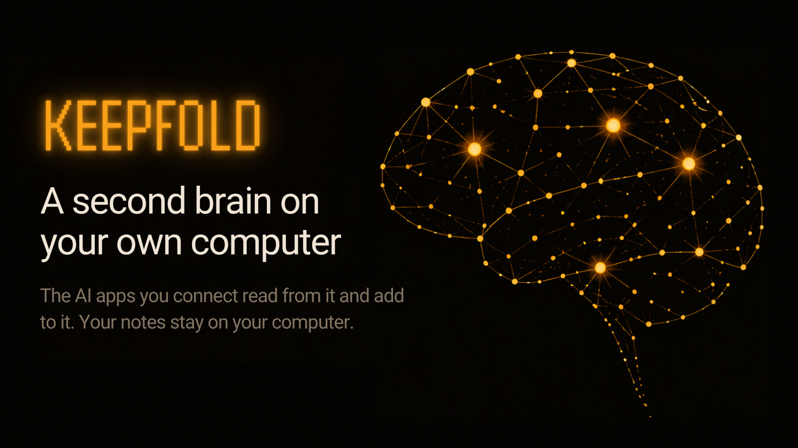
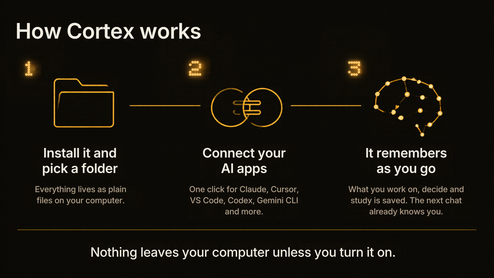
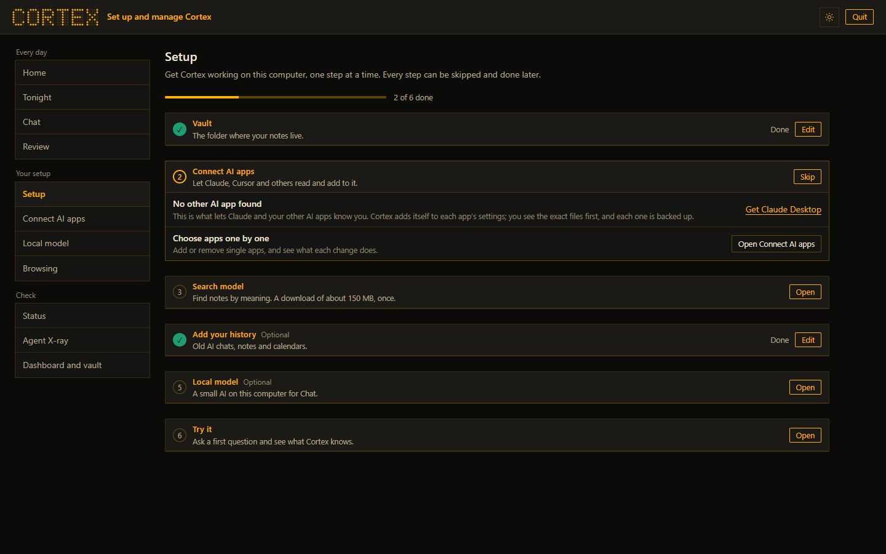
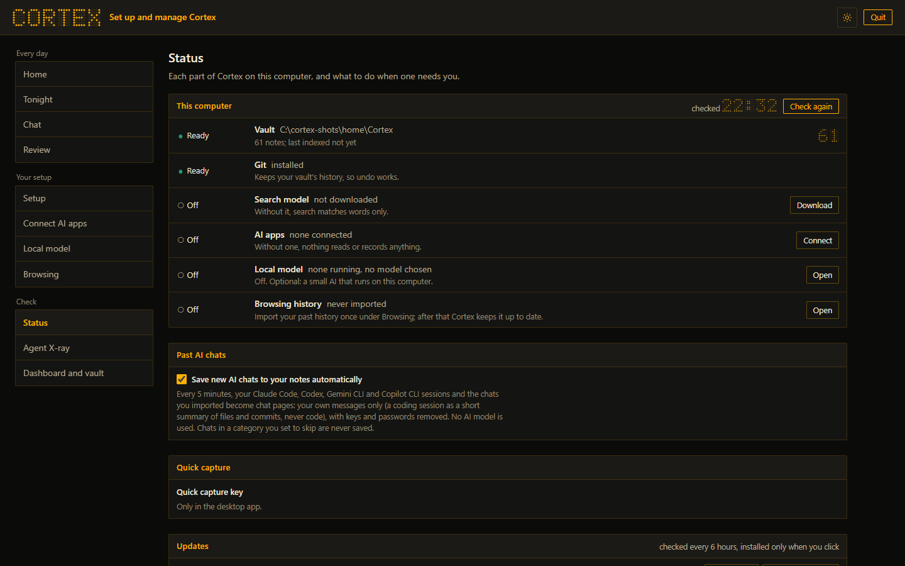
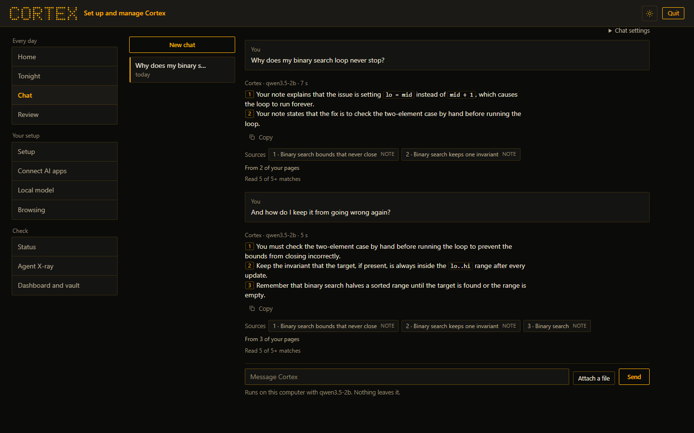
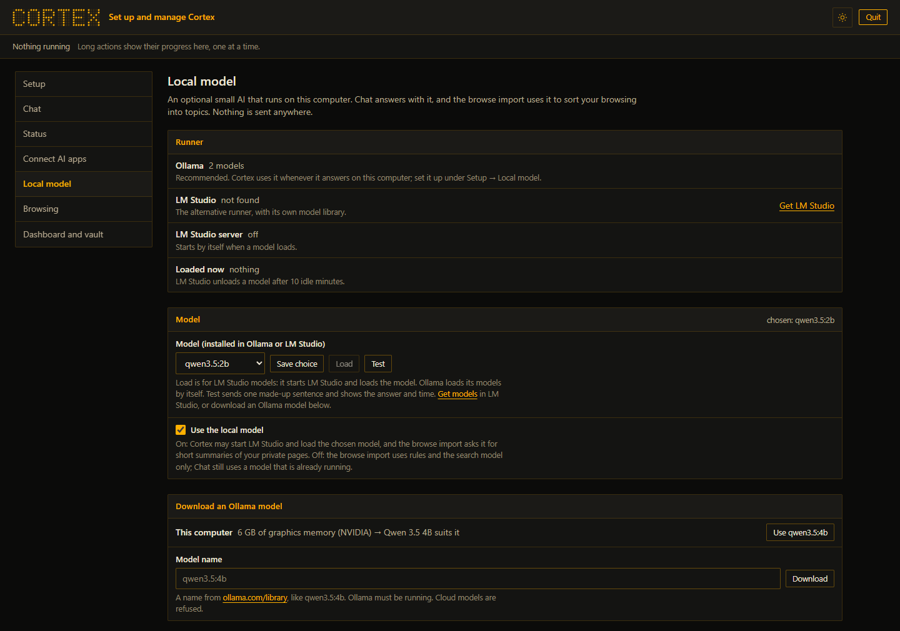
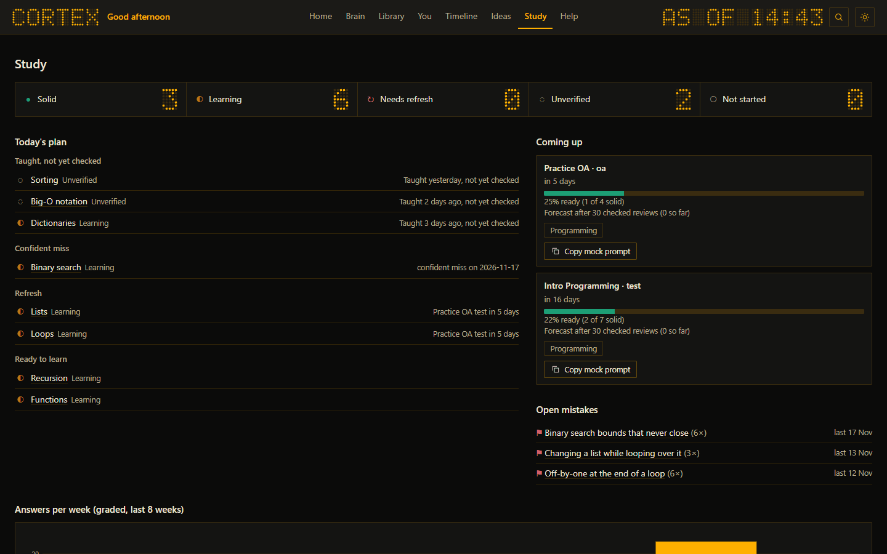
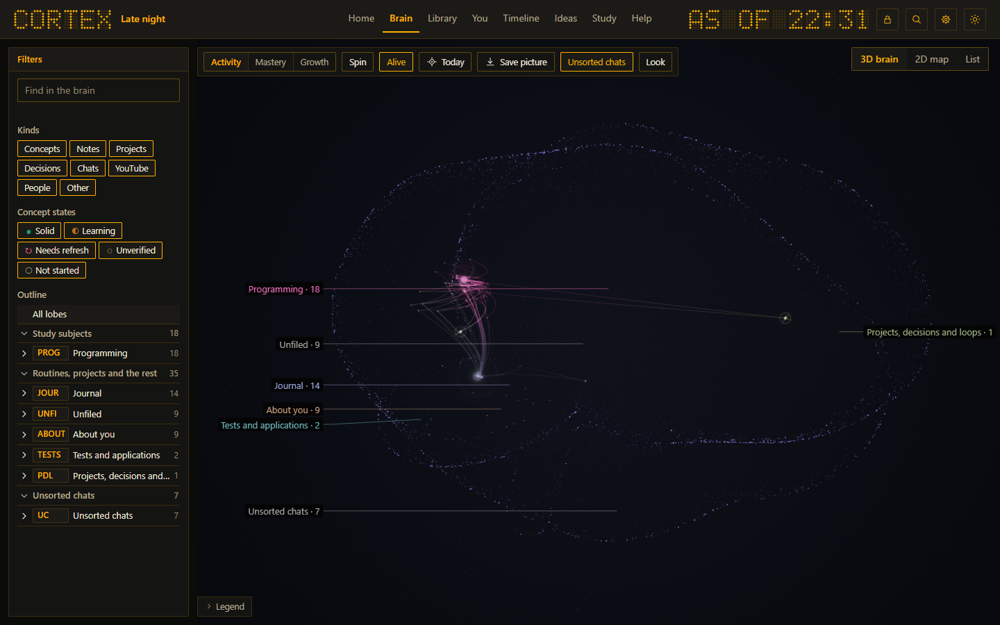
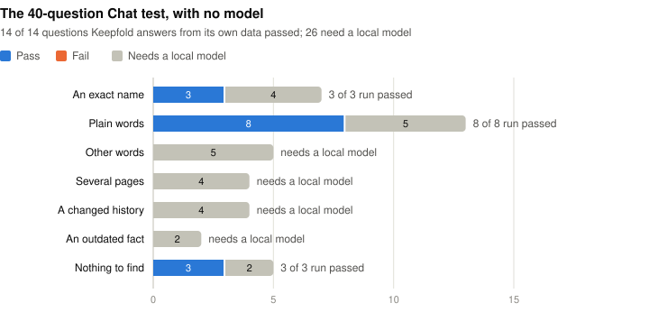
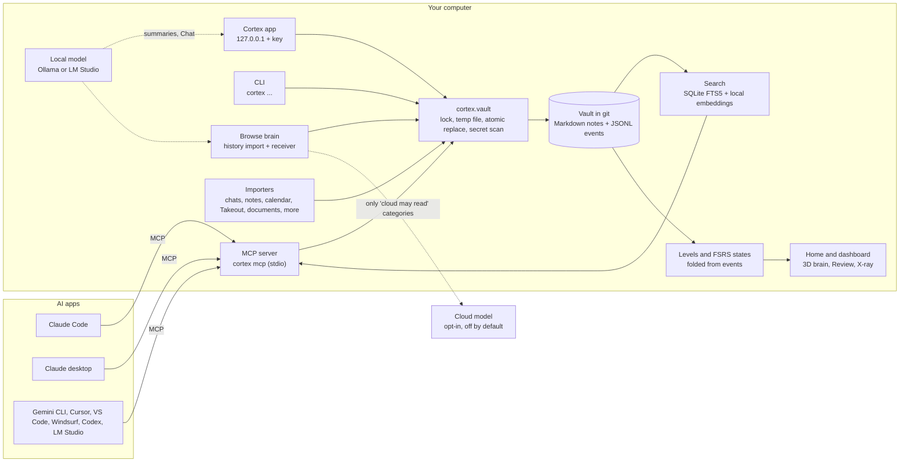

# Cortex

[](https://github.com/alenissacsam-2/cortex-learner/releases/latest)
[](#install)
[](#using-it)
[](LICENSE)

**Cortex is a memory for your AI apps that lives on your own computer: Claude, Cursor, Codex and the others read from it and add to it, so every new chat already knows you.**

**[Download Cortex for Windows](https://github.com/alenissacsam-2/cortex-learner/releases/latest/download/CortexSetup.exe)** (free, one file, no account)



- **It remembers for you.** Your AI chats, notes, decisions and what you read are saved by themselves, as plain notes in a folder you pick (your *vault*).
- **Every AI app starts out knowing you.** Connect an app once, in a click. Cortex plugs in through MCP, the standard way AI apps use outside tools.
- **It answers from your own data.** The app's Chat answers questions about your notes, chats and browsing, with sources, using an AI model on your computer.
- **It stays private.** No account and no telemetry. Nothing about you leaves your computer unless you turn it on.

*Every screenshot in this README shows the bundled sample vault of Sam, a made-up student, plus made-up demo data. None of it is a real person's.*

## How it works in 3 steps



1. **Install it and pick a folder.** Cortex keeps everything there.
2. **Connect your AI apps.** One click per app in the Cortex app.
3. **It remembers as you go.** Your chats, notes and decisions are saved by themselves.

## Contents

- [Made for vibe coding](#made-for-vibe-coding)
- [Who it is for](#who-it-is-for)
- [Is my data safe?](#is-my-data-safe)
- [A tour](#a-tour)
- [Install](#install)
- [FAQ](#faq)
- [Words you will see](#words-you-will-see)
- [For the curious and for developers](#for-the-curious-and-for-developers)
  - [What Cortex does](#what-cortex-does)
  - [The app, section by section](#the-app-section-by-section)
  - [Using it](#using-it)
  - [Privacy](#privacy)
  - [How well it works](#how-well-it-works)
  - [How Cortex differs](#how-cortex-differs)
  - [How it works](#how-it-works)
  - [Local models](#local-models)
  - [Install from source (macOS, Linux)](#install-from-source-macos-linux)
  - [Development](#development)
- [License](#license)

## Made for vibe coding

You build with Claude Code, Cursor, Codex or Gemini CLI. Each new chat forgets your project, your stack, the way you like code written and what you already decided, so you explain it all again. Cortex keeps those things and hands them to the app at the start of each chat.

**What an AI app gets.** Sam, the made-up student of the sample vault, types *"Add a save command to my text adventure game"*. Before the AI answers, Cortex gives it this (a real run on the sample, shortened):

```
## Related
- [[text-adventure]] — A small terminal game: rooms in a dict, one function per command.
- [[functions]] — Functions
- [[loops]] — Loops
```

The AI starts out knowing how the game is built. Sam's sample has no coding preferences, so none show here; with yours, the lines you pinned (say, "Python 3.12, type hints, uv only") and the preferences that fit the message come first.

**What it keeps for you:**

- Your projects, coding preferences and setup (your computer and tools).
- Decisions, including ones found in your git commit messages, which **Review** asks you to confirm.
- Your Claude Code chats, saved as short project summaries, never as code.
- Lines you start with `//pref:`, `//fact:` or `//forget:` in Claude, Codex or Gemini CLI, saved as your own words.

**How it reaches each app.** You connect once in the app's **Connect AI apps**; each change is shown first and each config file is backed up.

- **Claude Code:** a small script Claude Code runs for you (a hook) adds your context to your first real message of each chat.
- **Codex CLI and Gemini CLI:** the same, through their own hooks. Codex asks you to trust a new hook once: open `/hooks` in Codex after connecting.
- **Cursor, VS Code (Copilot) and Codex:** your pinned lines also go in the rules file each app reads, with a line asking it to load the rest from Cortex.

Cursor, VS Code, Codex and Gemini CLI see only what their profile allows: by default your pinned lines, coding preferences, setup and projects, never your journal, people pages or exams. You can change this per app.

## Who it is for

Anyone who works with AI apps every day.

- **Students:** what is due today, your repeat mistakes, mock tests, and how ready you are for the next exam.
- **Workers:** your projects, decisions and preferences, given to every coding agent, so you stop repeating yourself.
- **Researchers:** papers, notes and AI chats, searchable by meaning, with a Chat that answers from them and shows sources.

## Is my data safe?

- Your notes and chats stay on your computer, in a folder you choose.
- No account and no telemetry.
- No cloud AI model is used unless you turn one on. An AI app sees only what Cortex hands it.
- Notes you mark private stay out of what AI apps get. (One exception: an AI app that asks for a person's page by name gets it.)

[Read the full Privacy section.](#privacy)

## A tour


**Home:** what to do next, a live 3D brain of your notes, today's feed and a quick chat box.



**Setup:** six steps, one at a time. Every step can be skipped and done later.



**Status:** each part of Cortex on this computer, and what to do when one needs you.


**Add your history:** a three-step guide for each source, such as your old ChatGPT chats.


**Browsing:** you choose who may read each kind of site you visit.



**Chat:** ask about your own notes and chats; each answer lists the pages it used.

*A real run on the demo vault with Qwen 3.5 2B and the search model. A model this small can still get a detail wrong, so check the cited pages; a bigger model (4B, 9B) does better if your computer can run it.*



**Local model:** find, download and test an AI model that runs on your computer. Optional.



**Study:** today's revision plan, your coming tests and your open mistakes. It shows only if you study.


**Confidence mirror:** how often you were right, by how sure you said you were.



**Brain:** your vault drawn as a brain, one lobe per topic. Drag to turn it, click a page to see its links.

## Install

1. **Download** [CortexSetup.exe](https://github.com/alenissacsam-2/cortex-learner/releases/latest/download/CortexSetup.exe) (Windows 10 or 11).
2. **Run it.** The file is not signed, so Windows SmartScreen may say it "protected your PC": click **More info**, then **Run anyway**. Click **Install**. It needs the internet this once, for a few minutes, and no admin rights.
3. **Open Cortex.** A welcome guide walks you through the rest.

**Connect your AI apps:** [step-by-step for each app](docs/CONNECT.md). After connecting, restart Claude Code, or fully quit and reopen the Claude desktop app.

Later, open Cortex from the **Cortex** shortcut on the desktop or in the Start menu. It starts with Windows and keeps running in the tray when you close the window.

**Updating:** click **Restart to update** when it appears, or **Check for updates** under **Status** → **Updates** (Cortex 0.1.0 has no such button: run a newer `CortexSetup.exe` once). **Uninstalling:** click **Quit** in the app, then remove **Cortex** under **Settings > Apps > Installed apps**. Your vault and `~/.cortex` settings are kept; delete them yourself if you want them gone. Silent install options are in [docs/INSTALL.md](docs/INSTALL.md).

On macOS or Linux, or as a developer: see [Install from source](#install-from-source-macos-linux).

## FAQ

**Do I need to code?** No. You install Cortex, then click through the app. The terminal commands in this README are optional.

**Does it cost anything?** Cortex is free and open source (MIT). Your AI apps' own plans are separate. The optional local model is free; the optional cloud model is billed by whichever provider you use.

**Which AI apps work with it?** Claude Desktop, Claude Code, Codex CLI, Gemini CLI, Cursor, VS Code (Copilot), Windsurf, Antigravity and LM Studio connect in one click; Zed, Cline, GitHub Copilot CLI and JetBrains Junie can be connected too. For ChatGPT and Gemini on the web, which can't plug in, the app gives you a short "context pack" to copy and paste. [Step-by-step for each app.](docs/CONNECT.md)

**Is my data private?** Yes, by default. Everything stays in your folder and in `~/.cortex/` on your computer. An AI app you connect sees only what Cortex hands it (for Claude, that goes to Anthropic like the rest of your chat). Notes you mark private stay out of it, except a person's page that an app asks for by name. [The details.](#privacy)

**Will it slow my PC?** In our measurement on a vault of 1,000 made-up pages, a long-running Cortex process used about 510 MB of memory with its search models loaded, and about 190 MB after 10 idle minutes, when it lets the models go ([how we measured](docs/benchmarks/memory.md)). An optional local model needs more while it runs.

**Mac or Linux?** The installer is for Windows only, and Cortex is tested most on Windows. On macOS and Linux it runs from source: see [Install from source](#install-from-source-macos-linux).

**How do I report a problem?** Open an issue on the [Issues page](https://github.com/alenissacsam-2/cortex-learner/issues). For a security or privacy problem, report it privately as [SECURITY.md](SECURITY.md) explains, never in a public issue.

### Troubleshooting

Start with `cortex doctor` (or **Status** in the app): it checks each part and prints a fix for anything wrong.

**`cortex` is not found.** Run `uv tool update-shell`, then open a new terminal. (The Windows installer adds it to PATH for new terminals.)

**The Claude desktop app shows `cortex` as failed.** Use the full path to `cortex` in `claude_desktop_config.json` (find it with `where.exe cortex` or `which cortex`), then fully quit and reopen the app. [docs/INSTALL.md](docs/INSTALL.md) section 7 has the entry to paste.

**The first reply in a Claude Code chat is slow.** The plugin's hook is loading your context. It waits at most 3 seconds, then asks Claude to load it instead.

**The search model download failed.** Search still works with keywords. Retry with `cortex model download`.

**Doctor warns about cloud sync.** Move the vault out of OneDrive, Dropbox, Google Drive or iCloud: sync can break Cortex's file lock and copies private pages off your computer.

**`git push` is refused in my vault.** On purpose: the vault's pre-push hook keeps it local.

**My day ends late.** Cortex starts a new day at 04:00 in your computer's time zone.

**I don't study. Do I see the study parts?** No. The Study tab, exams and deadlines and the study lines on the home card appear only once your vault has a concept, a test or a grade.

**Can I use it without Claude?** Yes. Any MCP client can connect, and the CLI, the app and the dashboard work on their own. The `/cortex` study modes are a Claude skill.

**Where is my data?** In the vault folder you chose, plus settings and the search model in `~/.cortex/`. To remove everything, follow [docs/INSTALL.md](docs/INSTALL.md) section 11.

## Words you will see

| Word | In plain words |
|---|---|
| **Vault** | Your Cortex folder of plain notes and logs. |
| **AI app** | A chat or coding tool with an AI model, such as Claude or Cursor. |
| **MCP** | The standard way AI apps plug into tools. |
| **Chat** | The chat in the Cortex app that answers from your own data. |
| **Review** | A short daily list of things only you can decide. |
| **Home** | The Cortex app's first page. |
| **Local model** | An AI model that runs on your computer. Optional. |

[All the names, in plain words.](docs/GUIDE.md#8-the-names-in-plain-words)

## For the curious and for developers

Everything below is detail: what each part does, the full privacy rules, measured numbers, how Cortex is built and how to work on it. [docs/GUIDE.md](docs/GUIDE.md) is the full user guide.

## What Cortex does

Cortex keeps a picture of you and a store of what you know, in a folder of plain text files (Markdown notes and JSONL logs, the *vault*) that any editor can open. A software engineer can ask what they decided about a payments retry; a PhD student can ask which papers they read on contrastive learning; a student can ask what to revise tonight.

- **It remembers what you do.** Notes, decisions, projects, sources you read and facts about you are linked pages in the vault, and search finds them by meaning as well as by words.
- **Every AI app starts with your context.** In Claude Code, your first real message brings in your profile, your pinned core lines, the preferences that fit the message and a few related pages. Cursor, VS Code and Codex get your core lines in their rules file (the file that tells an app how to behave), and each app reads only what its profile allows.
- **It saves your AI chats.** Claude Code, Cowork and Claude desktop chats are saved as pages by themselves, with no model involved; coding sessions become short summaries, never code. You can import older exports from claude.ai, ChatGPT, Gemini and Perplexity.
- **It brings in the rest of your history.** Notes (Obsidian, Notion, any folder), calendars, documents (PDF, Word), your git projects, reading highlights (Kindle, Readwise, Pocket), sent mail, notes to yourself, Google activity (Search, YouTube and Chrome), location by city, photo dates, Spotify listening, voice memos (transcribed on your computer) and your browser history.
- **It tidies by itself.** What a chat infers about you is saved at once as a guess that AI apps see marked "(ask)". Near-duplicate lines collapse into one, and a newer line replaces the one it says it replaces. Each change can be undone. **Review** asks you about at most five things a day.
- **It answers from your own data.** **Chat**, on your computer, answers questions about your notes, saved chats, browsing and files you attach, with numbered sources. Counts, dates, site lists, day summaries and study questions are worked out by Cortex itself, so they work with no model at all.
- **It plans your study, if you study.** Quiz answers, grades and mistakes are added to a log that is never rewritten. Mastery levels and memory states (FSRS-6, a spaced repetition method that predicts when you will forget) are worked out from that log every time and never stored, so a wrong grade can be cancelled and everything recomputes. A daily plan orders what to revise. People who do not study never see these parts.
- **It stays on your computer.** No account and no telemetry. The vault is a normal Obsidian vault with its own git history (your choice, git is a tool that records every change), so every change can be reviewed and undone.

## The app, section by section

Cortex is its own Windows app: a window and a tray icon. The window shows a page served on this computer only (at 127.0.0.1, an address that no other computer can reach, with a key that changes each launch); `cortex app` opens the same page in a browser. [docs/GUIDE.md](docs/GUIDE.md) describes every section in full.

- **Private switch** (header, Windows Hello): shows private notes and private browsing for 10 minutes; minimising the window locks it again.
- **Saved chats:** past and new Claude Code, Desktop Code and Cowork chats become pages every 5 minutes, with no model. In the Claude desktop app's Chat tab, Claude logs each chat as it goes, and a safety net records topics a chat forgot to log.
- **Setup:** vault, connect AI apps, search model (a one-time download of about 150 MB; without it, search uses keywords only), add your history, local model, try it. Cortex never changes notes already in the folder you pick.
- **Add your history:** when a claude.ai, ChatGPT or Google Takeout export lands in your Downloads folder, Home offers to import it in one click.
- **Browsing:** after your first import, new history comes in by itself every 10 minutes while the app runs, since browsers keep only about 90 days. The local model checks new page titles only while the computer is idle and the model is already loaded.
- **Chat:** never uses a cloud model. **Attach a file** to ask about a PDF, Word or text file; **Save to your brain** imports it. Questions about your own record ("what's due?", "summarize my week", "which sites did I visit this month?") are answered from Cortex's data, even with no model.
- **Review:** at most five cards a day (**Today's 5**): lines that may steer an AI, teaching rules a chat suggested, lines that clash, corrections you repeated, decisions from your commit messages. Keys: J and K move, Y approves, N dismisses.
- **Tonight** (the start page between 8 p.m. and 4 a.m.): your day hour by hour, Today's 5, what each AI app saved today with one **Undo** per chat, and what is due tomorrow.
- **Agent X-ray:** what Cortex told each AI app in its first calls. **Pin** a line to serve it in every chat, **Mute** one to never serve it, choose what each app may read, and **Dry run** a message.
- **Local model:** pick, load, test and download models; an optional slower **Model for background work** handles browsing imports.
- **Home page tabs** (also `cortex dashboard`): Home, Brain, Library, You, Timeline, Ideas, Help, and Study once your vault has a concept, a test or a grade. **Export snapshot** saves an offline copy of your non-private pages with no network access (content security policy `default-src 'none'`).
- **Study:** a test's readiness forecast stays hidden until Cortex has 30 checked reviews to calibrate it. `cortex today --minutes 30` cuts the plan to fit; `/cortex mock paper 30` builds a timed paper from your weak spots; `/cortex sweep` asks 10 cold questions with "how sure? 1-4"; `cortex digest` suggests topics for imported chats (a yes is never a grade).

## Using it

### With Claude

Talk normally. In Claude Code, the plugin's prime hook (a small script Claude Code runs for you) adds a short Cortex context to your first real message of each chat (a greeting does not count); in the desktop app, Claude calls `cortex_prime`, the Cortex tool that loads that context, itself. Claude records lasting things as they come up and tells you briefly what it wrote. A line about who you are that Claude inferred is saved as a guess, marked "(ask)" until you confirm it. Start a line with `//pref:`, `//fact:` or `//forget:` and Cortex saves it as your own words.

Type `/cortex [mode] [topic]` for a deliberate session. The main modes:

| Command | What it does |
|---|---|
| `/cortex` | Home card: what's due and what's waiting for you |
| `/cortex learn [topic]` | Today's plan: retrieve first, teach the gap, re-test |
| `/cortex review` | Only what is due for a refresh |
| `/cortex short` | At most 5 small steps, for tired evenings |
| `/cortex sweep` | 10 cold questions across subjects, each with "how sure?" |
| `/cortex mock` | A mock interview; `/cortex mock paper [15\|30\|45]` for a timed paper |
| `/cortex week` | This week's numbers and the confidence mirror |
| `/cortex about <topic>` | What you know and have on a topic |
| `/cortex capture` | Save a source and the ideas worth keeping |
| `/cortex reflect` | The weekly review: confirm or drop lines about you, spot-check grades |
| `/cortex help` | Every mode and command |

[docs/GUIDE.md](docs/GUIDE.md) explains every mode, the 3D brain, browsing and the terms Cortex uses.

### In a terminal

| Command | What it does |
|---|---|
| `cortex app` | Open the Cortex app (`--no-open` prints the link only; `--port N` picks the port and stops if it is busy) |
| `cortex today --minutes 30` | Today's plan, cut to 30 minutes |
| `cortex import <file>` | Import a chat export, notes, a calendar, Google activity, documents, git projects, highlights and more; `--dry-run` shows counts, `--tier private` keeps imported pages private |
| `cortex ask "question"` | Answer from your notes, saved AI chats and browsing with your local model, with sources; `--private` adds private notes and private browsing (run it yourself, not through an AI app) |
| `cortex recall "query"` | Search your vault by meaning and keywords |
| `cortex doctor` | Health check, with a fix for each problem |
| `cortex backup` | Zip the whole vault, history included |
| `cortex undo <session>` | Revert one chat's changes |
| `cortex exclude add <folder>` | Turn Cortex off for chats in a folder |

`cortex --help` lists every command, and [docs/GUIDE.md](docs/GUIDE.md#4-terminal-commands-worth-knowing) explains the useful ones. The MCP tools and event schemas are in [docs/tools.md](docs/tools.md).

### Browsing

`cortex browse scan` shows counts of your browser history without writing anything; `cortex browse import` turns it into pages, private by default. New history then comes in by itself from your browsers' own history files. [docs/GUIDE.md](docs/GUIDE.md) section 6 covers every step and setting.

## Privacy

Cortex is local-first: it works on your computer, not in a cloud. [docs/PRIVACY.md](docs/PRIVACY.md) has the full detail; in short:

- **No account and no telemetry.** Your vault is a folder you choose; settings live in `~/.cortex/`.
- **What reaches the internet:** the one-time search model download; in the app, downloading Ollama or a local model when you click; and the app's update check, which asks GitHub for the latest Cortex release a minute after the app starts and every 6 hours (an installed Cortex downloads a newer installer in the background, and nothing is installed until you click **Restart to update**). Installing or upgrading fetches Python packages as usual.
- **Servers listen on 127.0.0.1 only**, an address no other computer can reach. The app needs a key that changes each launch. The MCP server talks to the AI app directly, not over the network.
- **What the AI model sees.** Whatever a Cortex tool returns goes to the AI app you are chatting with (Anthropic, when you use Claude). Pages marked `private: true` are left out of search, recall and context. `cortex exclude add <folder>` turns Cortex off for chats in one folder.
- **Browsing has three settings per category.** *Don't save* (adult, by default), *Local AI only* (health, money, betting, dating, sexuality, drugs and self-harm start here: only a model on this computer may read them), or *Cloud AI apps can read*. Nothing from browsing is visible to cloud AI apps until you turn that switch on. Sign-in, payment and bank pages are dropped and never stored.
- **The cloud model is off by default.** If you opt in, it may sort and summarise only the *Cloud AI apps can read* categories. It needs an HTTPS address, reads its API key from an environment variable you name (a setting of your computer; the app never takes a key), sends at most 500 requests a run unless you change the cap, refuses a request that looks like it holds a secret, and logs counts only. It never sees a skipped or local-only category, and if no local model is running, local-only data is skipped rather than sent.
- **Local models stay local.** Cortex talks to Ollama or LM Studio (programs that run models on your computer) on this computer only, ignores proxy settings and refuses models that a local runner forwards to the cloud.
- **Do not publish your vault.** It holds your profile and private pages; a pre-push hook (a git check that runs before sharing) in the vault refuses `git push`.

## How well it works

Every number in this section is measured by scripts in this repository on made-up data in a temp folder, never on a real vault. One command runs them all again and redraws the charts and tables below:

```
uv run python scripts/readme_numbers.py && uv run python scripts/readme_charts.py
```

The first script writes [docs/benchmarks/results.json](docs/benchmarks/results.json) (numbers only, with each benchmark's exact arguments); the second draws the charts and fills in the tables of this section.

<!-- numbers:machine -->
Measured on 2026-11-22 at commit `4bffbb2`, on AMD Ryzen 7 7435HS (16 logical cores), Windows-11-10.0.26200-SP0, Python 3.12.12. A section that says *Not measured yet* has no numbers in this run.
<!-- /numbers:machine -->

### Start-up and indexing

When an AI app starts Cortex, it can call Cortex's tools once the MCP server has answered its first message. The first time Cortex opens a vault it builds a search index of every note; after that it starts from a saved snapshot and reads only the notes that changed. Script: [scripts/bench_index.py](scripts/bench_index.py) (a vault with the mix of note kinds and lengths of a real one).

<!-- numbers:startup -->
*Not measured yet.* Run `uv run python scripts/readme_numbers.py && uv run python scripts/readme_charts.py` on a quiet machine to fill this in.
<!-- /numbers:startup -->

### Search by meaning

Search by meaning scores every chunk of every page against your question. Adding a page embeds only that page, so the store stays current as you write. These runs use a fast stand-in for the search model, so they time Cortex's own vector store and scoring; the real model adds the time it takes to embed your question. Script: [scripts/bench_scale.py](scripts/bench_scale.py) `vectors`.

<!-- numbers:semantic -->
*Not measured yet.* Run `uv run python scripts/readme_numbers.py && uv run python scripts/readme_charts.py` on a quiet machine to fill this in.
<!-- /numbers:semantic -->

### Chat's answers from your own data

Questions such as "which sites did I visit this week?", "summarize my day" or "what's due?" are answered from Cortex's records, not by a model. The vault here is heavy on purpose: 90 days of browsing with 2,000 sites a day, 10,000 notes and 20,000 study events. The first call after an import also reads the data into memory; later calls reuse it. Script: [scripts/bench_chat_data.py](scripts/bench_chat_data.py).

<!-- numbers:chat-data -->
*Not measured yet.* Run `uv run python scripts/readme_numbers.py && uv run python scripts/readme_charts.py` on a quiet machine to fill this in.
<!-- /numbers:chat-data -->

### The Chat test

The Chat test asks Chat 40 questions about a made-up person and scores each answer in code, with no AI judge (`cortex chat eval`, or **Run Chat test** in the app). These runs never load a model, so only the questions Cortex answers from its own data (counts, first and last dates, study states, an empty month, a private project with Private off) can run. The others are shown as needing a local model, not as failures. Source: [src/cortex/chat_eval.py](src/cortex/chat_eval.py), run by `readme_numbers.py` as `cortex chat eval --no-model` does.

<!-- numbers:chat-test -->
<picture><source media="(prefers-color-scheme: dark)" srcset="docs/images/charts/chat-test-dark.svg"></picture>

| The search a question needs | Pass | Fail | Needs a local model |
|---|---|---|---|
| An exact name | 3 | 0 | 4 |
| Plain words | 8 | 0 | 5 |
| Other words | 0 | 0 | 5 |
| Several pages | 0 | 0 | 4 |
| A changed history | 0 | 0 | 4 |
| An outdated fact | 0 | 0 | 2 |
| Nothing to find | 3 | 0 | 2 |
| **All 40** | **14** | **0** | **26** |
<!-- /numbers:chat-test -->

### Browsing history

The first import reads a whole year of history once. After that the app reads only what is new every 10 minutes, so a live read stays short. Script: [scripts/bench_scale.py](scripts/bench_scale.py) `browse` (no local model).

<!-- numbers:browse -->
*Not measured yet.* Run `uv run python scripts/readme_numbers.py && uv run python scripts/readme_charts.py` on a quiet machine to fill this in.
<!-- /numbers:browse -->

### Tests

<!-- numbers:tests -->
3,265 automated tests (`uv run pytest --collect-only -q`).
<!-- /numbers:tests -->
They use only made-up data in `tests/fixtures/` and temp folders.

### What is not measured here

- How good Chat's answers are with a local model: the 26 Chat test questions that need one. Run `cortex chat eval` with a 2B model loaded to see them.
- The real search model's time to embed a question or a page (the vector runs use a fast stand-in).
- How fast chat exports, notes, documents and the other sources import.
- Memory and disk use (beyond the snapshot size), the app's page load and the 3D brain's frame rate.
- macOS and Linux: every number above comes from one Windows laptop.
- Whether the study plan and readiness forecasts predict real test results.

## How Cortex differs

Other open-source memory projects, compared only on facts each one states in its own README and license. This table says nothing about their speed or quality.

| Project | License | Where the data lives | Storage | Models its README names |
|---|---|---|---|---|
| Cortex | MIT | A folder on your computer | Markdown and JSONL files (an Obsidian vault), with a SQLite search index | A local embedding model for search by meaning (optional); an optional local chat model (Ollama or LM Studio) |
| [Graphiti](https://github.com/getzep/graphiti) ([README](https://github.com/getzep/graphiti/blob/main/README.md)) | Apache-2.0 | A graph database you run (Neo4j, FalkorDB or Amazon Neptune); self-hosted | A temporal knowledge graph of entities, facts and episodes | An LLM and an embedder you supply; OpenAI by default, local servers such as Ollama or LM Studio through OpenAI-compatible endpoints |
| [Basic Memory](https://github.com/basicmachines-co/basic-memory) ([README](https://github.com/basicmachines-co/basic-memory/blob/main/README.md)) | AGPL-3.0 | Your disk; an optional paid hosted cloud | Markdown files, searched on SQLite or Postgres | FastEmbed embeddings; an optional reranker (a local FastEmbed cross-encoder or a LiteLLM provider) |
| [claude-mem](https://github.com/thedotmack/claude-mem) ([README](https://github.com/thedotmack/claude-mem/blob/main/README.md)) | Apache-2.0 | `~/.claude-mem` on your computer; cloud sync is opt-in | SQLite, with Chroma for semantic search | An observer model that turns tool activity into observations (its providers include Claude and OpenRouter) |

Licenses are from each repository's license as GitHub reports it; the rest is from each README as of November 2026.

## How it works



- **The vault is the source of truth.** Notes are Markdown with YAML front matter; learning evidence is JSONL events under `events/`. Every write goes through one module that takes a lock, writes a temp file and replaces the old one atomically, and refuses text that looks like a secret. With git on, each chat's changes are one git commit.
- **Everything else is derived and disposable**: the search index, the vector cache, levels, the plan and the dashboard. Delete them and Cortex rebuilds them.
- **Search** combines SQLite full-text search with a small embedding model that runs locally (about 150 MB, downloaded once).
- **Note text is treated as untrusted.** Over MCP it is wrapped in `<untrusted_note>` tags so the model can tell your notes from instructions; in cards and the dashboard it is escaped and stripped of links and images.

### A study session, step by step

1. You type `/cortex learn` in Claude. The skill calls `cortex_start`, which opens a session and returns the plan.
2. For each item Claude usually calls `cortex_ask` to log the question (and, when it has one, a short expected answer), then asks you. You answer and say how sure you are, 1 to 4.
3. Claude calls `cortex_grade` with the verdict, the hints used and any mistake. The server stamps the event's id, time and source; the tool input cannot set them.
4. The levels fold replays the log: the concept's state (Not started, Unverified, Learning, Needs refresh, Solid) and its FSRS memory card (stability, difficulty, next due date) update.
5. The next `cortex_start` or `cortex today` plans from the new state. When the chat ends, the session closes and its changes become one git commit; `cortex undo <session>` reverts it.

The tool schemas are in [docs/tools.md](docs/tools.md).

## Local models

A local model is optional. Cortex uses it to sort and summarise your browsing, to answer in **Chat** and to find facts about you in your recent chats while the computer is idle. It never leaves your computer.

- **Ollama** is recommended: the app's Setup can install it (`winget` on Windows, Homebrew on macOS; on Linux it shows the command).
- **LM Studio** is the alternative, through its own `lms` command.

Model sizes the app suggests (Qwen 3.5):

| Memory (graphics memory with an NVIDIA card, otherwise RAM) | Model |
|---|---|
| under 6 GB | `qwen3.5:2b` |
| 6 to 10 GB | `qwen3.5:4b` (the default) |
| 10 GB or more | `qwen3.5:9b` |

Without an NVIDIA card the app recommends at most the 4B model; the 9B one stays selectable. Without the app: install Ollama, run `ollama pull qwen3.5:4b`, add `localllm: {enabled: true}` to `~/.cortex/config.yaml`, and check with `cortex llm status`.

## Install from source (macOS, Linux)

This is also the way for developers. You need [uv](https://docs.astral.sh/uv/getting-started/installation/) and git. In a terminal:

```
git clone https://github.com/alenissacsam-2/cortex-learner ~/Cortex-app
cd ~/Cortex-app
uv tool install --editable .
~/.local/bin/cortex app
```

On Windows without the installer, use PowerShell:

```
git clone https://github.com/alenissacsam-2/cortex-learner "$HOME\Cortex-app"
cd "$HOME\Cortex-app"
uv tool install --editable .
& "$HOME\.local\bin\cortex.exe" app
```

Keep the `Cortex-app` folder: the installed program runs from it (it also holds the Claude Code plugin and the Chat skill). If a new terminal says `cortex` is not found, run `uv tool update-shell` and open a new terminal. [docs/INSTALL.md](docs/INSTALL.md) has every step for a first-time user, manual setup for each client, updating and a full uninstall.

Prefer a terminal to the app's Setup? `cortex setup` asks the core questions (vault, sample, search model, Claude Code plugin, Claude desktop config) and runs the checks. `cortex setup --dry-run` shows the plan and changes nothing; `cortex setup --sample` adds the sample vault of Sam, a made-up student, so you can try things at once (`cortex sample remove` clears it later).

## Development

```
git clone https://github.com/alenissacsam-2/cortex-learner cortex
cd cortex
uv sync
uv run pytest -m "not slow"   # the quick loop
uv run pytest -n auto         # the full suite on every core, before a commit
uv run pytest -m perf         # the timing benchmarks, alone (they skip under -n)
uv run ruff check
```

Always run Python through `uv run`. Tests use only synthetic data in `tests/fixtures/`; two read-only smoke tests run against a real vault only when `CORTEX_REAL_VAULT` is set. The rules for contributors and AI agents are in [CLAUDE.md](CLAUDE.md), and [filemap.md](filemap.md) describes every file.

- **README numbers:** `uv run python scripts/readme_numbers.py && uv run python scripts/readme_charts.py` re-measures everything in [How well it works](#how-well-it-works) on made-up data, redraws the charts and rewrites its tables. Run it on a quiet machine. `readme_numbers.py --quick` is a fast smoke run with small sizes.
- **Windows installer:** `uv run python installer/build.py` builds `dist/CortexSetup.exe` (Windows only). The sources are in [installer/](installer/).
- **The `/cortex` skill:** edit `skills/cortex/`, then run `uv run python scripts/build_skills.py` to refresh the plugin copy and `dist/cortex-skill.zip`.
- **A demo vault:** `uv run cortex init <folder>` then `uv run python scripts/make_demo_vault.py <folder>` fills a throwaway vault with Sam, the made-up student, and made-up study history, as in the screenshots. Never point it at a real vault.

Layout in brief: `src/cortex/` is the Python package (`vault.py` for every write, `events.py` for the log, `levels.py` for the folds, `planner.py` for Today, `mcp_server.py` for the tools, `cli.py` for the commands, `app/` for the Cortex app, `browse/` for browsing); `src/cortex/assets/` holds the dashboard and app pages; `plugin/` is the Claude Code plugin.

## License

MIT. See [LICENSE](LICENSE).
